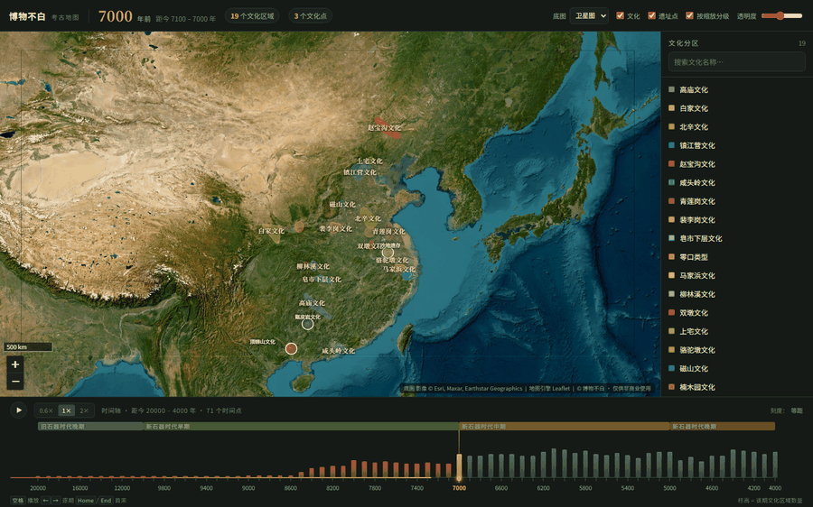
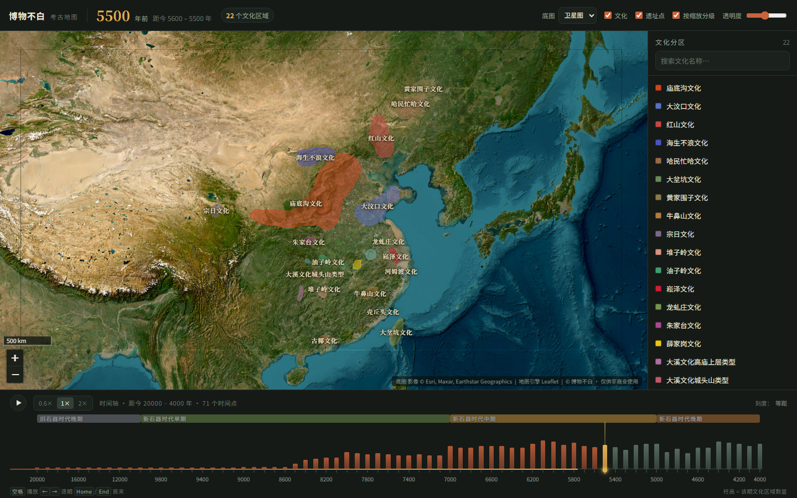
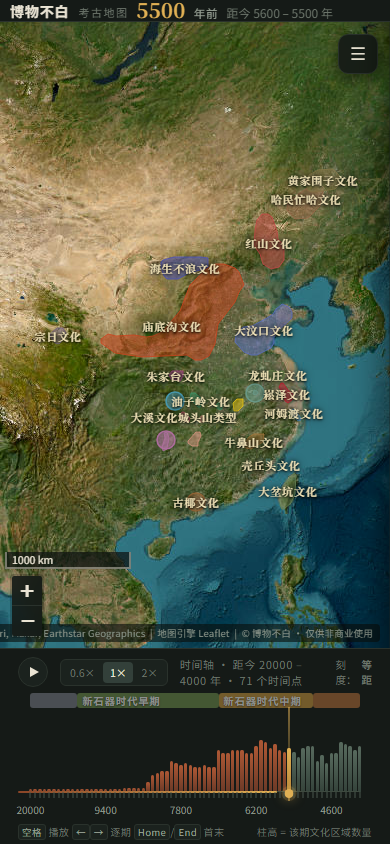

# 考古学文化地图 · 博物不白

> 一张可拖动时间轴的中国考古学文化分布地图，直观呈现距今 20000–4000 年中国境内考古学文化的兴衰与空间分布。

## 预览

**时间轴播放效果**（拖动时间轴，文化分布随年代变迁）：

**桌面端界面**（距今 5500 年，庙底沟期鼎盛）：

**移动端适配**（竖屏下地图全屏，文化列表收为抽屉）：

## 在线演示

点击下方链接直接在浏览器中体验（无需安装）：

**https://bowububai.github.io/bubaimap/**

## 项目简介

以「时间轴 × 地图」的交互方式，呈现旧石器时代晚期至新石器时代末期（约距今 20000–4000 年）中国境内考古学文化的分布与变迁。用户可沿时间轴拖动，观察不同文化在同一片土地上的先后更替、扩张与收缩。

地图覆盖距今 20000–4000 年，共 71 个时间点。每个时间点的文化分布面与遗址点会随时间轴联动变化。

## 功能特性

- **时间轴联动**：拖动底部时间轴或点击播放，动态查看各年代的文化分布格局。
- **比例尺分级**：根据缩放级别自动调整显示的文字信息量（小比例尺只显示文化名，放大后逐步显示遗址点名称），避免文字堆积。
- **帧间平滑过渡**：切换年代时，延续的文化面保持稳定，仅新增 / 消失的文化面做淡入淡出，过渡连贯无闪烁。
- **移动端适配**：手机竖屏下文化列表收为抽屉，地图全屏展示，支持触屏拖拽时间轴。
- **底图切换**：提供卫星影像与矢量地图两种底图。

## 快速开始

本项目为**纯静态单文件页面**，无需构建、无需后端：

1. 下载仓库中的 `index.html`；
2. 用浏览器直接打开即可（双击文件或拖入浏览器窗口）。

也可以把本仓库部署到任意静态站点托管服务（GitHub Pages、Netlify、Vercel 等），入口文件为 `index.html`。

## 使用说明

- 拖动底部时间轴切换年代帧，或点击播放按钮自动播放。
- 缩放地图查看不同比例尺下的文化面与遗址点。
- 点击文化面 / 遗址点查看名称；右侧列表可搜索、定位具体文化。
- 右上角下拉框切换卫星影像 / 矢量底图。
- 首次打开会显示项目说明弹窗，点击「进入地图」后不再重复显示。

## 数据说明

- 文化分布面为**学术示意范围**，非精确行政边界或实测遗址范围。
- 年代为近似值，测年本身存在偏差；文化分期之间的共时关系会因可视化需要做调整。
- 遗址点坐标基于公开资料与考古文献整理，个别点可能存在近似值（待实地核验）。
- 4000 年之后的内容正在制作中，当前版本暂不展示。

本项目为文化科普展示，**仅用于学习与参考**，不替代正式考古报告与学术研究。

## 底图与数据来源

- **底图**：[Esri World Imagery / World Topo Map](https://www.esri.com/)（免费公开的全球影像与地形服务，WGS84 / Web 墨卡托坐标系）。
  - 说明：本仓库为开源版本，采用无需密钥、无调用配额的 Esri 底图，任何人可直接运行。在线演示版则使用天地图作为合规默认底图。
- **数据**：整理自公开考古文献与资料。

## 版权与许可

© 博物不白 · 仅供非商业使用

本项目采用 [CC BY-NC-SA 4.0（署名-非商业性使用-相同方式共享 4.0 国际）](LICENSE) 协议授权：

- **署名（BY）**：使用本项目内容须注明「博物不白」；
- **非商业（NC）**：不得用于任何商业目的；
- **相同方式共享（SA）**：基于本项目的衍生作品须采用相同协议共享。

## 免责声明

本项目为个人学习研究项目，文化面与遗址点数据可能存在误差，使用者应自行核实并自行承担使用风险。
